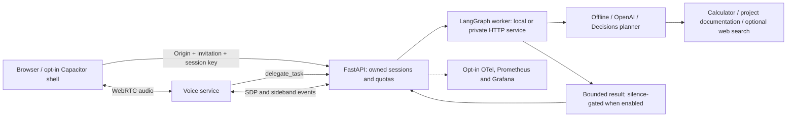

# voice-delegate

[](https://github.com/savbiz/voice-delegate/actions/workflows/ci.yml)
[](LICENSE)

**A fast voice conversation. A separate worker for the heavy lifting.**

## Independence

This is a personal project by Savino Bizzoca. It is independent and not affiliated with,
endorsed by, or derived from my employer's products, code or internal information. It is
also not affiliated with or endorsed by OpenAI, Microsoft Azure or any other provider
named in this documentation; product names are used descriptively. Copyright 2026 Savino
Bizzoca, Apache-2.0.

Ask a question, delegate a calculation or a documentation lookup, and keep talking.
The voice model knows one tool, `delegate_task`; a bounded LangGraph worker handles
calculation, cited project documentation and optional public web search. Preserving
work while the user speaks requires the opt-in intent-cancellation mode described below.

## Try it locally

Prerequisites: Python 3.12 or 3.13, uv, Node.js 24, pnpm 11.19.0 and make. From the
repository root, install dependencies once:

```sh
uv sync --locked
cp .env.example .env  # First setup only; preserve an existing .env and its keys.
cd frontend
pnpm install --frozen-lockfile
cd ..
make fe
```

Open **http://localhost:5173**, select **Free demo**, then start. It is scripted,
silent and free: no microphone, backend or provider key is required.

For local live voice, put your real `OPENAI_API_KEY` in the private root `.env`.
Start the backend in another terminal, then get the local invitation in a third:

```sh
make be
```

```sh
make invite
```

Paste that invitation in the browser and select **Live voice**. Stop each server
with Ctrl+C. `make` shows help. Existing `.env` values override code defaults; the
launcher changes local admission only, never your file or provider key.

The server template defaults to the **offline worker planner**. To let the worker
interpret natural-language requests using Luna, choose the paid planner explicitly:

```sh
VOICE_WORKER_MODE=openai make be
```

Voice provider usage and text-worker usage are billed separately. A ChatGPT
subscription does not supply an API key. See the [copyable local configuration](docs/local-development.md#copyable-local-configuration)
and [all variables, allowed choices and bounds](docs/configuration.md).

### One-command offline stack and Codespaces

With Docker running, this starts the API, separate worker, frontend, Prometheus,
Grafana and collector without any provider key:

```sh
bash .devcontainer/start-demo.sh
```

Open **http://localhost:8080** and use **Run offline worker**. Unlike the scripted
browser demo, this executes the real worker graph with a deterministic planner.
See [offline stack](deployment/README.md#offline-stack-in-one-command) for inspection
and shutdown commands. Codespaces uses the same stack; keep forwarded ports private.

[](https://codespaces.new/savbiz/voice-delegate)

## Status and verification

**v0.1.0 is an implementation release.** Offline tests cover session ownership,
limits, worker tools, cancellation, recovery, metrics and browser behavior.
The maintainer reported successful local GPT-Live conversations and tool use; the
full recorded live acceptance checklist is still pending. A small live Decisions
API smoke is recorded separately; it does not establish cancellation quality.

The [hosted frontend](https://voice-delegate.vercel.app) can run the simulated demo
without the backend. Railway is the canonical deployment target, but its trial
expired: this README does not claim the [configured API](https://voice-delegate-api-production.up.railway.app/healthz)
is currently available or running the latest commit. Hosted documentation search
and live voice require a healthy backend, invitations and applicable provider keys.

Codespaces offline worker/metrics acceptance was reported on 2026-10-25; the
startup/origin fixes are covered offline, while a new hosted rerun and cold-start
timings remain pending. iOS Simulator and Android debug builds compile; device
microphone, audio routing and store publication are separate acceptance work.

See [current evidence and remaining gates](docs/roadmap.md), the
[live checklist](docs/milestones/live-verification.md), [benchmarks](docs/benchmarks.md)
and the [two-minute video script](docs/demo-video.md). The script is preparation,
not a published demo video. No measured provider comparison, live Luna evaluation
or Azure recovery result is claimed.

## Providers and worker modes

`VOICE_ADAPTER` selects an integration; the old `VOICE_VOICE_PROVIDER` name remains
a deprecated alias. All adapters expose the same delegation boundary.

| Adapter | Voice service and transport | State |
|---|---|---|
| `live` | OpenAI GPT-Live; browser WebRTC audio and backend sideband | Default; partial local smoke reported |
| `realtime` | OpenAI Realtime; browser WebRTC audio and backend sideband | Implemented; full live acceptance pending |
| `azure` | Azure OpenAI Realtime; browser WebRTC and backend sideband | Primary or optional one-attempt recovery; live acceptance pending |

ElevenLabs Agents integration is an incomplete [separate draft](https://github.com/savbiz/voice-delegate/pull/21),
not an available adapter in this branch. Cross-vendor fallback, SIP telephone entry
and worker MCP connections are not implemented here.

The worker uses **LangGraph for orchestration** and a selected planner for decisions:

| `VOICE_WORKER_MODE` | How a step is chosen | External usage |
|---|---|---|
| `offline` | Deterministic scripted planner, real local tools | No model calls |
| `openai` | Text model selects tools and writes the final answer | OpenAI; configurable model, default `gpt-6-luna` |
| `decisions` | Decisions chooses an action; code builds supported arguments, text model writes the answer | OpenAI Decisions and text-model calls |

`VOICE_WORKER_EXECUTION=local` runs that graph inside the API process. `remote`
uses a separately started private HTTP worker service; it can be another container
on the same machine. It does not automatically deploy another service. Both modes
retain the selected planner and limits. See [worker configuration](docs/worker.md).

The worker has `calculate` and `search_documentation`. Optional `web_search` needs
`VOICE_WEB_SEARCH=true` and a private Tavily key on the worker host; it is off by
default and may incur search-provider charges. A web result is untrusted data and
ends further tool selection for that delegation. The voice model still sees only
`delegate_task`, never these individual tools. [Prompts](agent/src/voice_delegate_agent/prompts/)
are versioned with the worker.

[Voice instructions and session design](docs/architecture.md).

## Interruption, cancellation and delivery

The default path retains the original cancellation behavior. Opt into the separate
work/narration lifecycle with `VOICE_INTENT_CANCELLATION=true`:

- Speaking interrupts narration while delegated work continues.
- Up to two tasks run independently; a new delegation does not cancel the previous one.
- Results wait for silence, then are sent to the voice provider, or expire after a bounded wait.
- Explicit UI/API cancellation and session end cancel work. Optional semantic cancellation
  additionally requires `VOICE_DECISIONS_CANCEL=true`; failure leaves work running.

“Result sent” means the provider accepted it, not that the user heard the complete
answer. Interrupted audio is not automatically repeated. Task execution and delivery
wait are shown separately. See [ADR 009](docs/decisions/009-cancellation-is-intent.md).

## Data flow and limits



Audio goes directly between the browser and voice provider. Backend-owned sessions,
queues, history, model steps, results and external requests have explicit limits.
Invitations, quota SQLite stores and leases control public access. Provider recovery
creates a new browser peer and replays bounded text, never tool executions.

Optional `VOICE_AUDIO_TIMING=true` measures browser audio onset/playback separately
from the always-labeled transcript timestamp gap. A transcript gap is not acoustic
latency; browser measurements are proxies, not a hardware loopback measurement.
See [measurement methodology](docs/benchmarks.md) and [observability](observability/README.md).

Ordinary diagnostics exclude conversation text. Server debug recording requires
`VOICE_DEBUG_RECORDING=true` and session consent; it stores bounded data for up to
24 hours while the backend runs. Audio recording is a separate browser-only consent
and download. The operator can read server debug recordings. See [operations](docs/operations.md).

## Checks

From the repository root:

```sh
uv run ruff check .
uv run ruff format --check .
uv run mypy
uv run pytest --cov=voice_delegate --cov=voice_delegate_agent --cov-fail-under=85
uv run python scripts/check_independence.py
uv run python scripts/check_deployment.py
uv run python scripts/check_links.py
uv run python scripts/build_reference.py --check
uv build --all-packages
```

From `frontend/`:

```sh
pnpm lint
pnpm build
pnpm test
pnpm exec playwright install chromium  # Once, if the browser is not installed.
pnpm test:e2e
pnpm test:stack
```

CI checks Python 3.12 and 3.13, builds/smokes the backend and offline demo containers,
and syncs the opt-in native scaffold. Python tests disable external sockets; browser
tests use local fakes. Installing dependencies/browsers needs internet; testing does
not require provider credentials or paid requests.

## Documentation

- [Architecture](docs/architecture.md), [API](docs/api.md), [glossary](docs/glossary.md) and [ADRs](docs/decisions/)
- [Configuration](docs/configuration.md), [local development](docs/local-development.md), [worker setup](docs/worker.md)
- [Deployment](deployment/README.md), [operations](docs/operations.md), [production scope](docs/production.md)
- [Benchmarks](docs/benchmarks.md), [worker evals](evals/README.md), [roadmap and acceptance](docs/roadmap.md)
- [Native packaging](docs/mobile.md), [third-party notices](THIRD_PARTY_NOTICES.md) and [contributing](CONTRIBUTING.md)

Public protocol sources are cited in the design documents and ADRs. The project is
Apache-2.0; dependencies and bundled data retain their individual licence terms.
