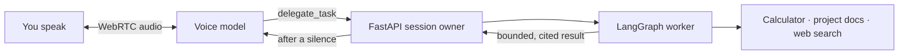

# voice-delegate

[](https://github.com/savbiz/voice-delegate/actions/workflows/ci.yml)
[](LICENSE)
[](https://github.com/savbiz/voice-delegate/releases)

**A fast voice conversation. A separate worker for the heavy lifting.**

Talk to a real-time voice model and keep talking while slower work happens in the
background. The voice model knows exactly one tool, `delegate_task`. A bounded LangGraph
worker does the calculation, cited project-documentation lookup or optional web search,
and the answer is spoken when you pause. Interrupting the voice never throws that work away.

<p align="center">
  
</p>

- **Three voice providers, chosen per session:** OpenAI GPT-Live, Azure (a GPT-Live
  deployment) and ElevenLabs Agents.
- **Background delegation:** up to two tasks run at once; results wait for silence and
  carry the original request.
- **Your keys or the platform's:** bring your own provider keys (memory only) or use an
  invitation code with daily quotas.
- **Cost estimates** per session, optional Azure recovery, OpenTelemetry metrics and an
  opt-in iOS/Android shell.

## How it works



Audio flows directly between the browser and the voice provider. The backend owns the
session, admission, quotas and delegated work; the voice model never sees the worker's
individual tools.

## Try it

- **Hosted:** open [voice-delegate.vercel.app](https://voice-delegate.vercel.app). Choose
  **Your API keys** to use your own provider account, or **Platform API** with an
  invitation code. No code? Use **Request access** on the page and the maintainer is notified.
- **No keys at all:** **Tools & examples → Offline example** plays a scripted session
  for free, with no microphone or backend.
- **Locally:** see below.

## Run it locally

Prerequisites: Python 3.12 or 3.13, [uv](https://docs.astral.sh/uv/), Node.js 24, pnpm and make.

```sh
uv sync --locked
[ -e .env ] || cp config/local.env.template .env   # then add your OPENAI_API_KEY
(cd frontend && pnpm install --frozen-lockfile)
make be       # terminal 1: API on http://127.0.0.1:8000
make fe       # terminal 2: UI on http://localhost:5173
make invite   # terminal 3: prints the local invitation code
```

Paste the code, choose **Live voice** and start talking. Without a key, the worker runs
its offline planner and **Tools & examples → Offline example** still works. Voice and
text-worker usage are billed separately by the provider; a ChatGPT subscription is not an
API key. Details: [local development](docs/local-development.md) and the
[configuration reference](docs/configuration.md).

No keys at all? `bash .devcontainer/start-demo.sh` starts the API, a separate worker, the UI
and Prometheus/Grafana with a deterministic planner on http://localhost:8080, also in
[](https://codespaces.new/savbiz/voice-delegate).

## Status

Every feature is covered by offline tests and CI, and the maintainer has used each voice
provider live on the hosted demo. Recorded live acceptance is the gate for v1.0.

| Area | Works today | Not yet claimed |
|---|---|---|
| OpenAI GPT-Live | Live conversations and tool use | Recorded acceptance checklist |
| Azure | Live sessions as primary provider | Live recovery, measured latency |
| ElevenLabs Agents | Live on the deployed backend | Formal acceptance, cost reconciliation |
| Worker | Offline suite, 40-case evals, a live Decisions smoke | Live Luna evaluation |
| Hosted demo | Vercel UI, [Railway API](https://voice-delegate-api-production.up.railway.app/healthz), invitations, quotas | Cold-start timings |
| Native shells | iOS Simulator and Android debug builds compile | Device audio, store release |

Evidence and remaining gates: [roadmap](docs/roadmap.md) and
[live checklist](docs/milestones/live-verification.md).

## Documentation

Everything else (design, worker modes, interruption and delivery rules, deployment,
operations, configuration and decision records) is in the
[documentation index](docs/README.md). Contributing and checks: [CONTRIBUTING.md](CONTRIBUTING.md).

## Independence and licence

This is a personal project by Savino Bizzoca. It is independent and not affiliated with,
endorsed by, or derived from my employer's products, code or internal information. It is
also not affiliated with or endorsed by OpenAI, Microsoft Azure or any other provider
named in this documentation; product names are used descriptively.

Copyright 2026 Savino Bizzoca. Licensed under [Apache-2.0](LICENSE); dependencies and
bundled data retain their individual licence terms ([notices](THIRD_PARTY_NOTICES.md)).
