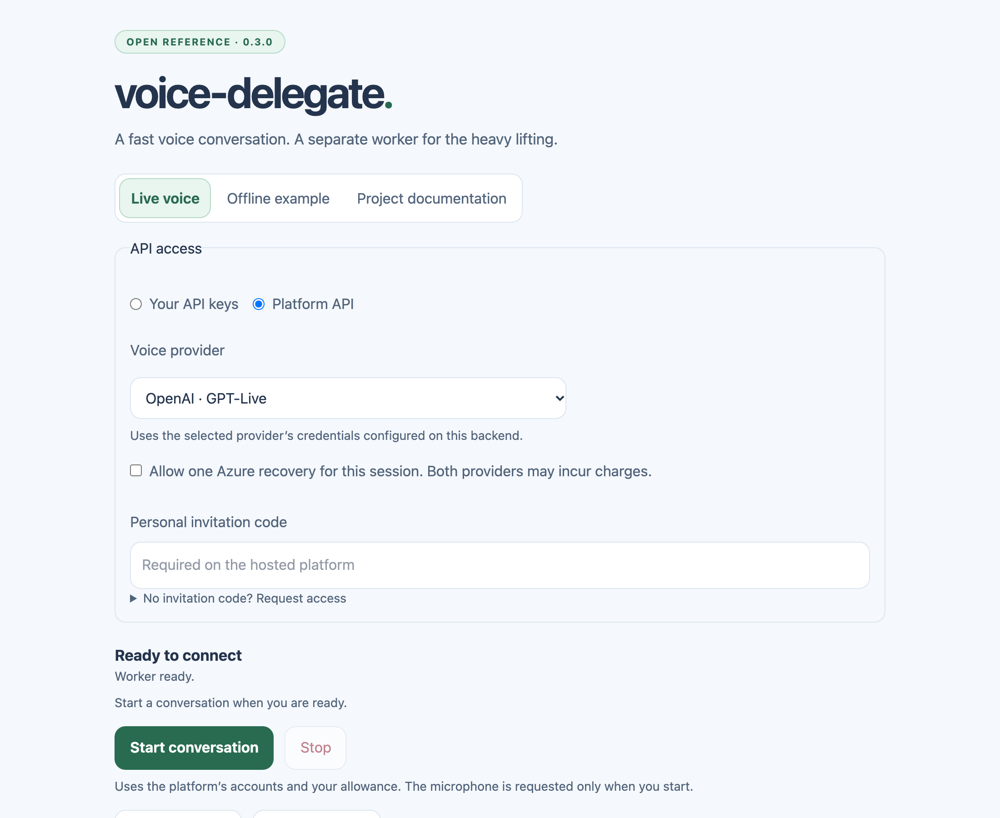
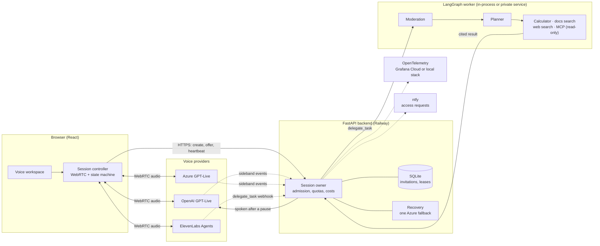

# voice-delegate

[](https://github.com/savbiz/voice-delegate/actions/workflows/ci.yml)
[](https://github.com/savbiz/voice-delegate/actions/workflows/health.yml)
[](.github/actions/backend/action.yml)
[](LICENSE)
[](https://github.com/savbiz/voice-delegate/releases)

**A fast voice conversation. A separate worker for the heavy lifting.**

Talk to a real-time voice model and keep talking while slower work happens in the
background. The voice model knows exactly one tool, `delegate_task`. A bounded LangGraph
worker does the calculation, cited project-documentation lookup or optional web search,
and the answer is spoken when you pause. Interrupting the voice never throws that work away.

<p align="center">
  
</p>

Reviewing this repository? [Start here](docs/start-here.md) for a five-minute reading path.

## What's implemented

A complete, deployed system, not a prototype:

- **Real-time voice** with three providers chosen per session: OpenAI GPT-Live, Azure
  (a GPT-Live deployment) and ElevenLabs Agents. Audio goes over WebRTC straight from the
  browser to the provider.
- **Background delegation:** the voice model has a single tool, `delegate_task`. A bounded
  LangGraph worker runs up to two tasks at once (calculator, cited documentation search,
  optional web search, optional read-only MCP tools) and the answer is spoken when you pause.
- **Safety:** read-only tools only; optional moderation that reviews goals and tool
  results and quarantines instructions injected into retrieved text; MCP limited to an
  operator allowlist and gated by moderation.
- **Access and cost control:** bring your own keys (held in memory only) or use invitation
  codes with durable daily quotas; Request access with approval from a phone notification;
  per-session cost estimates.
- **Reliability:** bounded session lifetimes, heartbeats, one consented Azure recovery,
  explicit client state machine, separate worker service for scaling.
- **iOS and Android:** the same React app packaged with Capacitor as an opt-in native shell;
  iOS Simulator and Android debug builds compile, with native voice gated behind a test
  build ([mobile](docs/mobile.md)).
- **Evaluations:** 40 versioned worker cases scored deterministically and by an LLM judge,
  run offline on every CI push and against real models on demand, with results tracked as
  Braintrust experiments ([evals](evals/README.md)).
- **Engineering:** FastAPI + React 19 + TypeScript, uv and pnpm workspaces, about 1,000
  automated tests (pytest, Vitest, Playwright end-to-end), strict typing and linting,
  a Locust load test against the offline stack ([load testing](docs/load-testing.md)), CodeQL, OpenTelemetry traces and metrics (local Prometheus and Grafana, or Grafana Cloud
  with importable dashboards), 13 decision records.
- **Delivery:** Railway (infrastructure as code) and Vercel, tagged releases with a
  changelog, a daily health check and a one-command offline demo for Codespaces.

## System design



Audio flows directly between the browser and the voice provider. The backend owns the
session, admission, quotas and delegated work; the voice model never sees the worker's
individual tools.

## Try it

- **Hosted:** open [voice-delegate.vercel.app](https://voice-delegate.vercel.app). Choose
  **Your API keys** to use your own provider account, or **Platform API** with an
  invitation code. No code? Use **Request access** on the page and the maintainer is notified.
- **No keys at all:** the **Offline example** tab plays a scripted session
  for free, with no microphone or backend.
- **Locally:** see below.

## Run it locally

Prerequisites: Python 3.12 or 3.13, [uv](https://docs.astral.sh/uv/), Node.js 24, pnpm and make.

```sh
uv sync --locked
[ -e .env ] || cp config/local.env.template .env   # then add your OPENAI_API_KEY
(cd frontend && pnpm install --frozen-lockfile)
make be       # terminal 1: API on http://127.0.0.1:8000
make fe       # terminal 2: UI on http://localhost:5173
make invite   # terminal 3: prints the local invitation code
```

Paste the code, choose **Live voice** and start talking. Without a key, the worker runs
its offline planner and the **Offline example** tab still works. Voice and
text-worker usage are billed separately by the provider; a ChatGPT subscription is not an
API key. Details: [local development](docs/local-development.md) and the
[configuration reference](docs/configuration.md).

No keys at all? `bash .devcontainer/start-demo.sh` starts the API, a separate worker, the UI
and Prometheus/Grafana with a deterministic planner on http://localhost:8080, also in
[](https://codespaces.new/savbiz/voice-delegate).

## Status

Every feature is covered by offline tests and CI, and the maintainer has used each voice
provider live on the hosted demo. Recorded live acceptance is the gate for v1.0.

**Live dashboard:** [latency, errors and estimated cost from the hosted demo](https://valiantocelot1730.grafana.net/public-dashboards/22ada44e8fa241b98648a33f34de9b98)
(Grafana Cloud, last 30 days, read-only). Traffic is light, so some panels are sparse.

**Eval results:** [40 worker cases with GPT-6 Luna: 98% judged correct, 99% grounded in cited sources, 0 failures](https://www.braintrust.dev/app/savibiz/p/voice-delegate/experiments/openai-20261104T144642-6b482952)
(public Braintrust experiment, 2026-11-04; synthetic cases from `evals/data/worker-v4.json`).

| Area | Works today | Not yet claimed |
|---|---|---|
| OpenAI GPT-Live | Live conversations and tool use | Recorded acceptance checklist |
| Azure | Live sessions as primary provider | Live recovery, measured latency |
| ElevenLabs Agents | Live on the deployed backend | Formal acceptance, cost reconciliation |
| Worker | Offline suite, 40-case evals, a live Decisions smoke | Live Luna evaluation |
| Hosted demo | Vercel UI, [Railway API](https://voice-delegate-api-production.up.railway.app/healthz), invitations, quotas | Cold-start timings |
| Native shells | iOS Simulator and Android debug builds compile | Device audio, store release |

Evidence and remaining gates: [roadmap](docs/roadmap.md) and
[live checklist](docs/milestones/live-verification.md).

## Documentation

Everything else (design, worker modes, interruption and delivery rules, deployment,
operations, configuration and decision records) is in the
[documentation index](docs/README.md). Contributing and checks: [CONTRIBUTING.md](CONTRIBUTING.md).

## Independence and licence

This is a personal project by Savino Bizzoca. It is independent and not affiliated with,
endorsed by, or derived from my employer's products, code or internal information. It is
also not affiliated with or endorsed by OpenAI, Microsoft Azure or any other provider
named in this documentation; product names are used descriptively.

Copyright 2026 Savino Bizzoca. Licensed under [Apache-2.0](LICENSE); dependencies and
bundled data retain their individual licence terms ([notices](THIRD_PARTY_NOTICES.md)).
