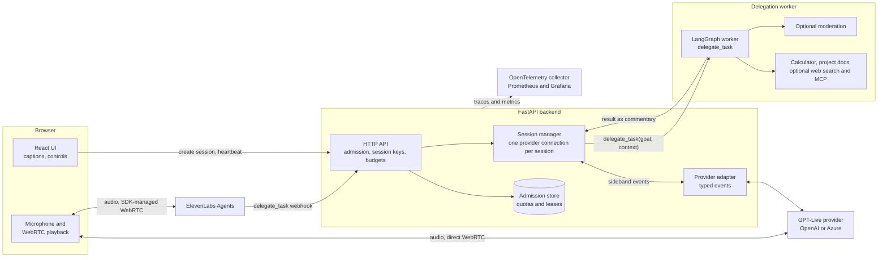
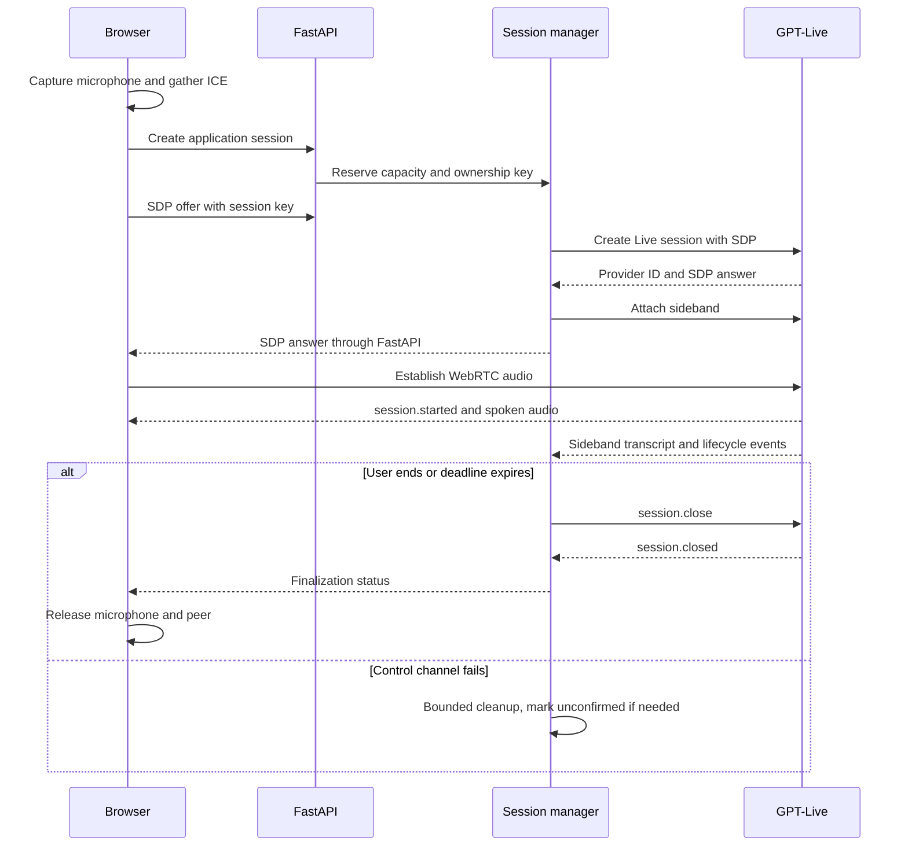
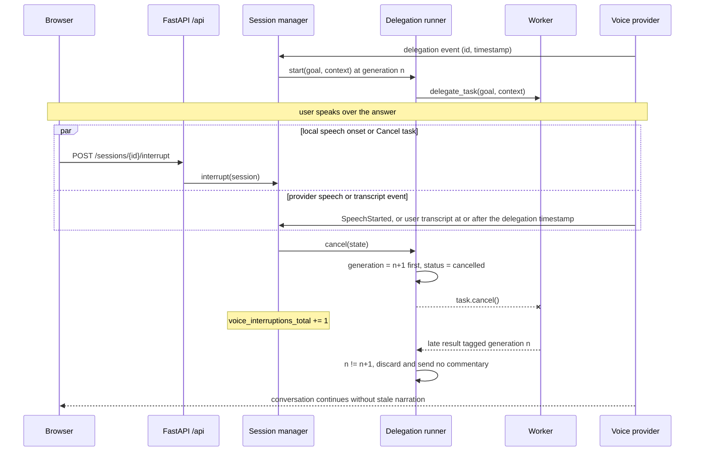
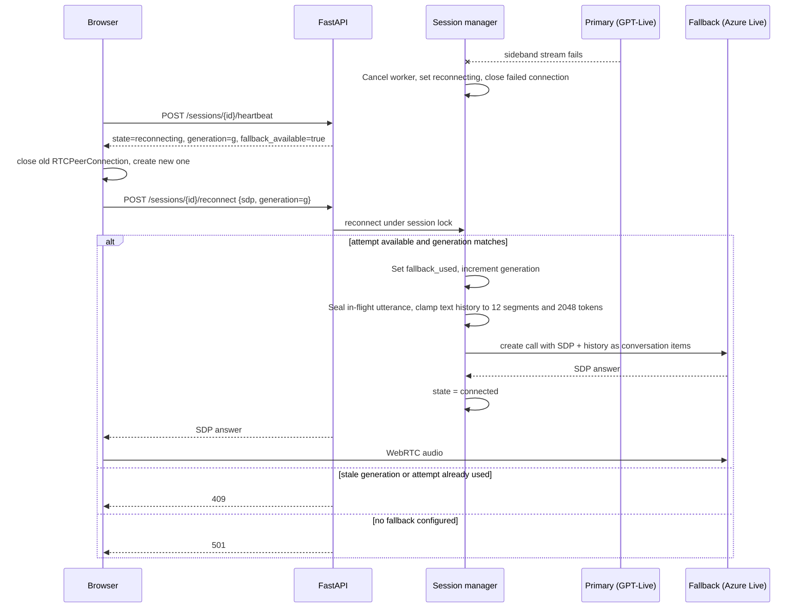
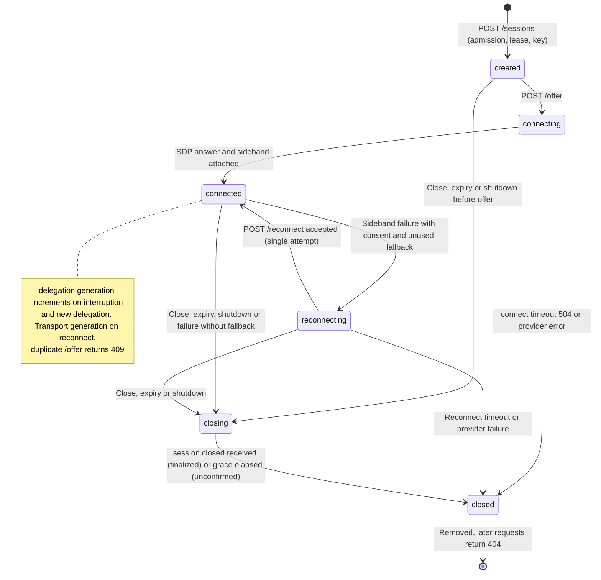

# Architecture

## Boundaries

The browser owns microphone capture, WebRTC playback, and display-only captions. FastAPI owns
admission, session capability keys, time budgets, and server credentials. The session manager
owns exactly one provider connection per application session and is the sole executor of
delegation requests. The provider adapter translates public wire events into typed application
events. The application runs a LangGraph worker behind `delegate_task(goal, context)`.

Keeping audio on a direct media connection avoids an application audio hop. A sideband provides
server-side authority without routing the microphone through Python. Backend results enter as
commentary, separate from trusted instructions.

The worker runs inside the API process or, in the scaled and offline stacks, as a separate private
service. Audio media bypasses the backend; session control, lifecycle events, transcripts and
delegation requests and results are all handled by it. OpenAI and Azure sessions use a sideband
event channel; ElevenLabs Agents use browser-managed WebRTC and call the backend through a webhook.

The session manager dispatches delegation to a LangGraph worker in the background. Bounded transcripts provide goal/context. Results return through commentary; interruptions invalidate the active generation before cancellation. See [worker execution](worker.md) and [ADR 005](decisions/005-bounded-delegation.md).

## Lifecycle

When the primary control stream fails, the browser can request one fallback connection with bounded text history:

Diagram HTTP paths are relative to `/api`. The interruption counter is incremented by `SessionManager.interrupt` only while delegation is running. Transcript-based interruption additionally requires real provider timing; for ElevenLabs Agents, a user transcript reported by the browser SDK emits `SpeechStarted` as the onset event.

The normal transport lifecycle is `created → connecting → connected → closing → closed`. A single fallback attempt adds `connected → reconnecting → connected`; a failed attempt marks the session closed and releases its admission lease. For GPT-Live on OpenAI and Azure, `connected` means SDP and sideband setup completed and the browser separately handles `session.started` to display voice readiness; ElevenLabs Agents use SDK-managed WebRTC with no SDP answer, so the session becomes `connected` when `SessionManager.attach_sdk` receives the browser-reported SDK connection. A session lock serializes offer, reconnect and close operations. A duplicate offer returns 409. Closed sessions are removed rather than retained indefinitely. Repeating the internal close is safe; a later HTTP request for an already-removed session returns 404.

A single WebSocket reader receives lifecycle events even while close is waiting. Queue exhaustion ends event consumption with an error rather than dropping delegation or termination messages silently. Graceful finalization may be unconfirmed after overflow or a transport failure. The browser heartbeat maintains liveness; it never resets the absolute session deadline.

## API

All `/api` routes require the configured exact Origin. Session, reference and feedback routes require the configured shared code or personal invitation. Public-demo deployments require personal invitations; the shared code is for private testing. CORS allows only the explicit frontend origin. Session routes with `{id}` also require `X-Session-Key`; reference IDs are public corpus identifiers, not session keys.

| Method and path | Meaning |
|---|---|
| `GET /healthz` | Process health; no provider call |
| `POST /api/config` | Return `requires_access_code`, `voice_available`, `feedback_available` and `access_request_available` booleans |
| `POST /api/sessions` | Reserve an application session; return ID, key, TTL |
| `POST /api/sessions/{id}/offer` | JSON SDP offer; return SDP answer |
| `POST /api/sessions/{id}/reconnect` | New SDP offer and current generation; consume one configured fallback attempt |
| `POST /api/sessions/{id}/heartbeat` | Refresh browser liveness and return state |
| `POST /api/sessions/{id}/close` | Close and report finalization confirmation |
| `POST /api/sessions/{id}/interrupt` | Invalidate and cancel the active worker |
| `POST /api/sessions/{id}/token` | 501 for GPT-Live; adapter capability boundary |
| `POST /api/reference/search` | Search the bundled corpus with a bounded query |
| `POST /api/reference/{id}` | Read one source excerpt by corpus ID |
| `POST /api/feedback` | Store a bounded diagnostic report and an optional typed note, without conversation content |

## Private worker service API

The worker requires `Authorization: Bearer <VOICE_WORKER_SERVICE_TOKEN>` for all job routes; missing or invalid credentials return 401. It belongs on the same host/private network, not on the public ingress. Full schemas and errors are in [API contracts](api.md).

| Method and route | Response | Additional errors |
|---|---|---|
| `POST /jobs` | 202, job status | 409 fingerprint conflict; 422 input/deadline; 429 capacity or record limit |
| `GET /jobs/{key}` | 200, status, text and source IDs | 404 missing/expired; 422 invalid UUID |
| `DELETE /jobs/{key}` | 200, cancelled status/tombstone | 422 invalid UUID; 503 full cancellation ledger |

## Resource budgets

| Limit | Default | Reason and exhaustion behavior |
|---|---|---|
| Concurrent application sessions | 4, configurable | Bound sockets and spend; admission returns 429 |
| Absolute lifetime | 300 s, configurable | Bound duration-based voice cost; server closes |
| Missing heartbeat | 45 s, configurable | Reclaim abandoned tabs and setup reservations |
| Connect deadline | 20 s, configurable | Bound setup; recovery cleanup can add up to 10 s |
| Graceful close wait | 5 s, configurable | Avoid indefinite shutdown; finalization may be unconfirmed |
| WebSocket close handshake | 2 s | Bound transport cleanup after grace period |
| HTTP request body | 64 KiB | Reject large bodies before JSON parsing, including chunked bodies |
| Sideband frame queue / message size | 16 / 1 MiB | Bound reflected media and event memory |
| Normalized event queue | 64 | Fail on slow consumers rather than accumulate stale work |
| WebSocket write high-water mark | 32 KiB | Backpressure for outbound control messages |
| Commentary write deadline | 2 s | Prevent stuck sends from blocking event handling indefinitely |
| Commentary content | 500 UTF-8 bytes | Conservative wire guard alongside configurable token accounting |
| Browser captions / timing rows | 6,000 characters per speaker / 20 | Bound DOM memory during long sessions |

WebRTC audio buffers belong to the browser and provider. We do not claim to bound those with a Python queue. An audio relay would need its own explicit buffer limits.

## Provider adapters

`OpenAILiveProvider` implements GPT-Live WebRTC setup, sideband events, commentary and finalization.
`AzureLiveProvider` uses the Azure `/openai/v1/live` namespace with Bearer authentication,
the same Live events, and client delegation. Recovery requires session consent and seeds
at most twelve bounded text fragments through `session.thinking.append`, never tool calls.
The app factory registers `openai`, `azure` and optionally `elevenlabs`; the Realtime
adapters were removed in 0.3.0. See [session flow](session-flow.md).

## Speech interruption authority

Provider-side speech detection is authoritative for interruption. The browser's local
energy detector is a latency optimisation, not a replacement for provider events.
It analyses the remote audio element's `srcObject` with the same onset detector at a
higher threshold. While unmuted remote playback has measurable speech energy, local
speech-onset interrupts are suppressed to avoid loudspeaker echo cancelling work.
Local detection rearms after 300 ms of remote silence and requires a fresh onset.
Paused, muted and silent remote audio do not indefinitely block local detection.
Provider speech-start events can still interrupt during remote playback; headphones and
real-device testing remain necessary to assess acoustic behaviour.

## Worker, fallback and admission contracts

Cancellation invalidates the generation before cancelling tasks. Results from workers
that return after cancellation are discarded. A result already sent to the voice provider
cannot be withdrawn, and cancellation cannot undo a completed external action.

Timeout limits how long a worker result is awaited. It cancels the worker and sends a
short failure message. Provider transmission has its own two-second deadline, outside
the worker execution budget. Noncooperative workers occupy capacity until they finish.

Only sealed text segments are replayed during fallback, bounded to twelve entries and
2048 tokens. For Live, a speaker change seals preceding segments; reconnect also seals
every trailing in-flight segment. Tool calls, tool results and
audio are never replayed. History is conversation data, never system instructions.

A provider stream failure retains the owned session in the reconnecting state and closes
the failed connection immediately. Browser transport failure starts recovery with a new
peer. An authenticated reconnect request consumes one fallback attempt under the session
lock. Azure fallback preserves lifetime and admission limits; stale requests return 409.

Cleanup reports failure if either provider's finalization was unconfirmed. A lost creation
response can leave an unknown upstream call; no subsequent request can reliably identify
that call for cleanup. Creation requests are never automatically retried.

All session operations require both the user's invitation and the session ownership key.
A different valid invitation cannot operate the session even if it knows its key.
Shared-code setups remain available for private testing when public demo mode is disabled.

SQLite records daily quota reservations before admitting a session. Only hashes of stable
user IDs, UTC dates, counts and reserved seconds are stored, never tokens or transcripts.
The single API process needs durable writable quota storage across deployment and rollback.

Set `VOICE_DEMO_ENABLED=false` and restart to disable new demo sessions with status 503.
Existing close and heartbeat routes retain authorization. Provider-side spend controls
remain necessary because crashes and remote cleanup failures can outlive local deadlines.

The worker allows four model steps by default and one tool per model response.
Configurable step and duration budgets stop unbounded loops, while token and byte limits
keep delegated results compact enough for narration.

The offline planner is deterministic, not a free language model. It exercises the real
LangGraph graph and read-only tools with English commands, without provider calls.
Natural-language planning requires the separately configured paid text model.

## Optional intent cancellation

By default, speaking pauses narration while independent worker
jobs continue. Up to two running or pending jobs occupy bounded slots. Speech alone no
longer cancels work. Explicit task cancellation, session end, enabled semantic decisions
and the existing worker execution timeouts still cancel work. The existing
interruption path and diagrams describe the default mode; this optional path amends it.

The browser sends owner-authenticated `/activity` reports with boolean microphone/remote
energy states, sequence and transport generation. Fresh observed silence releases one
bounded pending result with a request preamble. Stale reports hold delivery; missing audio
analysis eventually expires the result. Another result waits until assistant audio has been
observed. Provider speech events reset the gate, and provider VAD remains authoritative for
interrupting audio already playing. This is not an acoustic guarantee; live validation is pending.

The event reader never awaits a worker or classifier. An optional Decider classifies the
latest bounded utterance with cancellation and relevance predicates per active task. A
classification timeout or error preserves work. Jobs survive a transport replacement and
are delivered through the new connection, never under an old delegation ID. See [ADR 009](decisions/009-cancellation-is-intent.md) for budgets,
terminal acknowledgements, pricing caveats and the default-off rollout.

Task duration includes waiting for delivery and stops at the terminal state. The owner heartbeat
separates worker execution time from delivery wait. Consent-based debug files record task
lifecycle timestamps and durations; normal application logs do not contain task text. A `completed`
task means the result was sent to the voice provider, not that its narration was fully heard.
The UI retains last-reported task states after session end; interrupted narration is not
automatically repeated. Transcript bubbles group consecutive segments from the same speaker
without changing the underlying provider transcript events. The backend separately reconstructs
bounded conversational turns across overlapping speakers for recap and worker context, while
keeping sealed provider segments for fallback replay. The recap's latest request joins the user
turns since the previous assistant reply, because providers can split one spoken request into
separate final transcripts. Delegation context explicitly identifies
the preceding user turn alongside bounded conversation text. Both are untrusted data; the worker
uses the recent topic to resolve corrections and asks for clarification when ambiguous.

## Native client preview

The opt-in Capacitor client packages the React frontend as local iOS/iPadOS and
Android assets; it uses the existing API, invitations, quotas and single voice
`delegate_task` tool. It does not embed a provider key or load Vercel as a remote app.
Native voice is disabled unless explicitly enabled in a test build. Its requests
retain browser Origin checks: the exact iOS `capacitor://localhost` origin requires
an explicit native-origin allowlist entry; Android uses
`https://localhost`. Backend hosts remain unchanged.

Native backgrounding releases local media and requests session close. Calls do not
continue in the background or automatically resume. The native build has its own
local-asset CSP, keeps native HTTP overrides disabled, and preserves server-side
session expiry as the final cleanup boundary. Offline fake/API checks do not verify
native WebRTC or device audio. See the [mobile preview guide](mobile.md).

## Optional public web evidence

With a configured Tavily key, the worker registry adds a bounded `web_search`
tool. The voice model still sees only `delegate_task`. Calculation and project
retrieval remain local. The HTTP search adapter owns a total deadline and response
cap; it does not fetch pages from returned URLs. Failure discloses a fallback to the
bundled documentation. See [worker configuration](worker.md#optional-public-web-search)
and [ADR 011](decisions/011-read-only-web-search.md).

Web search is a terminal evidence step: the graph rejects any subsequent tool call.
Sources receive stable URL-derived IDs and validated citation indices. Private worker
job responses include a bounded `web_sources` collection; the API validates these
before exposing them through the normal session source panel. Transport validation
and citations do not establish that the external text is true or safe to repeat.
System prompts ship as Markdown resources inside the backend and agent packages,
with server-selected variants matching enabled tools and cancellation behavior.

## Optional moderation boundary

With `VOICE_MODERATION` and an OpenAI key on the worker host, the worker reviews the
delegated goal and each documentation, web or tool result before the planner sees it.
Verdicts are allow, quarantine or refuse, decided by deterministic policy over advisory
classifier signals. Withheld evidence ends the job as incomplete and is never narrated or
cited. See [ADR 013](decisions/013-moderation-boundary.md).

## Optional MCP tools

Operators can list audited MCP servers and the exact tools the worker may call
(`VOICE_MCP_SERVERS`, which requires moderation). The voice model still sees only
`delegate_task`. Each delegation uses an immutable, cached, schema-reviewed snapshot of
`server__tool` names; results are moderated, cited as evidence and terminal like web
evidence. See [ADR 010](decisions/010-mcp-trust-model.md).

## Browser audio observations

The WebRTC stream analyser automatically
observes local and remote energy every 20 ms. Remote energy is accepted only while
playback is active and unmuted. Offer-to-first-audio includes setup; speech-end-to-audio
uses the last local energy observation followed by at least 300 ms of silence.
Overlap and interrupted sampling are excluded. These browser observations do not
measure acoustic output or provider-only generation latency and use no transcript timestamps.

The browser sends numeric samples to the owned session's `/audio-timing` route with
its transport generation. The backend validates the connected state, generation,
finite duration (0–120 s) and a 120-sample session cap. Only the fixed setup/turn label
is exported to OTel; no session identifiers or conversation content are metric labels.
Uploads time out after two seconds, are not retried, and never end the call. If Web Audio
is unavailable, conversation continues with the existing transcript diagnostics.
See the [measurement procedure](milestones/live-verification.md) for exclusions and
[video storyboard](demo-video.md) for the pending cancellation-design dependency.

## Isolated offline stack

The optional demo Compose stack runs a static frontend proxy, the session API with an
explicit fake-provider factory, a separate private worker using OfflinePlanner, and
the existing collector/Prometheus/Grafana stack. A fixed fake transcript triggers
`delegate_task`; worker commentary returns as a synthetic transcript and heartbeat recap.
The browser uses owned HTTP sessions rather than pretending the fake SDP is playable
WebRTC. There is no microphone, generated audio or measured voice latency in this mode.

Production factories and the public static demo remain unchanged. The demo factory
requires `VOICE_OFFLINE_DEMO=1` and rejects provider keys, paid planning, fallback and
transcript recording. The frontend build opts in with `VITE_OFFLINE_STACK=true`.
Only loopback frontend and monitoring ports are published. A known fixture bearer value
protects the private worker interface from accidental unauthenticated calls; it is not
production authentication. See [offline deployment](../deployment/README.md#offline-stack-in-one-command).

The private Codespaces proxy may rewrite same-origin browser requests to
`Origin: https://localhost:8080`. The demo persists an exact origin list including
both localhost schemes and its forwarded URL. Route checks, CORS and limiter
rejections use the same `VOICE_ALLOWED_ORIGINS` list; the deprecated singular alias
is used only when no list is configured. nginx continues to set the backend Host
to localhost. See the [measured procedure](local-development.md#measured-codespaces-proxy-behaviour).

## Optional Decisions worker planning

`VOICE_WORKER_MODE=decisions` selects DecisionsPlanner inside the same bounded LangGraph
worker. Each step classifies the next action against current tool names/descriptions,
`direct` and `refuse`. Server code builds tool arguments; an unbound text model generates
final prose. The voice adapter continues to expose only `delegate_task`.

The shared agent-level `Decider` contract supports predicates and choices without an
agent-to-backend dependency. The backend provides the bounded HTTP implementation;
local and private worker factories own and close the planner clients. Cancellation
classification remains independently controlled by its existing opt-in flag.

A failed classification uses the existing text planner for that step. Refusals stop
without fallback, cancellation propagates, and ambiguous tool arguments require
clarification. Input/output caps, classification and task deadlines, and the graph's
step limit bound both paths. This is verified offline with deterministic fakes;
live semantic accuracy and cost remain pending. See [worker limits](worker.md#decisions-worker-planner)
and the [reproducible comparison](../evals/README.md#planner-comparison).

## Isolated voice measurement harness

The opt-in [benchmark](benchmarks.md) runs outside the product UI. A local Playwright
page sends fixed WAV input through the existing owned session/offer API and direct
WebRTC connection. It observes received playback energy and delegation events, closes
each session, and retains case IDs, input hashes and speech-end offsets, timings, outcomes,
provider/model labels, browser version, run date and source revision/state. Provider keys
remain on the backend; provider/model labels in the capture are operator declarations,
not browser configuration authority. No new application route or voice tool is added.

The default path uses a local WebRTC tone pair and scripted scorer fixtures. Live mode
requires explicit environment and CLI opt-ins plus a session budget. Its recordings are
local inputs, not bundled user data. A bounded exporter can retrieve timing-only trace
projections from an existing Grafana Tempo data source; the checked-in Grafana stack
still provisions only Prometheus. No queryable trace storage or live result is implied.

## Optional ElevenLabs Agents transport

The [Agents integration](elevenlabs.md) uses direct browser WebRTC media and an authenticated async server webhook for delegate_task. The existing local/remote worker and silence-gated portfolio stay on the backend; the browser supplies owned activity/transcript observations but never submits tools or polls results. Exact goals coalesce per conversation, and HTTP responses carry bounded results. Provider finalization requires status evidence; live acceptance remains pending. See the [transport evaluation](decisions/012-elevenlabs-agents-webhook.md).

## Session accounting

[Cost estimates](cost-estimates.md) are default-on, session-scoped numeric ledgers with frozen price assumptions, remote usage propagation and fixed aggregate component labels.

## Session provider selection

The [session UI](session-ui.md) selects from a server-owned adapter registry before creation; each session keeps its provider, while ElevenLabs never uses Azure recovery.

## Planned extensions

[MCP, moderation, SIP and cascaded audio](future-extensions.md) have design notes and diagrams only; they retain one voice-facing delegate_task tool and require separate opt-in implementations and acceptance.

## Sources

Reviewed public documentation on 2026-09-20:

- [GPT-Live WebRTC](https://developers.openai.com/api/docs/guides/voice-webrtc?api=live)
- [GPT-Live sideband](https://developers.openai.com/api/docs/guides/voice-server-controls?api=live)
- [Session lifecycle](https://developers.openai.com/api/docs/guides/live-conversations)
- [Delegation](https://developers.openai.com/api/docs/guides/live-delegation)
- [FastAPI lifespan](https://fastapi.tiangolo.com/advanced/events/)

Application limits and ownership rules are first-principles design choices, not upstream service guarantees.

## Personal API access

The voice workspace can create an isolated, bounded personal-key session without a platform
invitation. Its provider clients and local/remote planner use only that session’s supplied
keys. The platform registry retains the owned session for expiry and capacity enforcement,
while its personal manager owns worker cancellation and client cleanup. No user key is
written to persistent state or exposed in session/cost responses. The private worker uses
a distinct `/personal-jobs` endpoint so old workers cannot silently spend platform keys.
See [personal API access](personal-api.md) for lifetime, limits and ElevenLabs setup.
