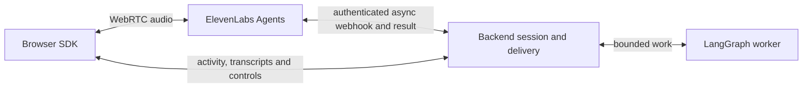

# ADR 012: ElevenLabs Agents with an asynchronous server webhook

Status: accepted 2026-11-02

Context: ElevenLabs offers Agents (SDK-managed WebRTC with client or server tools) and a
standalone WebSocket Realtime API. The project needs a second voice vendor that keeps the
single `delegate_task` boundary, the worker and the silence-gated delivery unchanged.

Decision: use Agents WebRTC for media and one **webhook** tool, `delegate_task`, with
`execution_mode=async`. The browser gets a backend-minted conversation token; audio goes
directly to ElevenLabs. The backend admits the job and answers the provider's HTTP request
with the bounded result once the delivery gate allows it.

Consequences:

- The webhook route sits outside the browser `/api` Origin policy. A stored header secret and
  the reserved conversation ID bind each request to a session this backend minted; tool
  arguments cannot choose a principal, credential, worker or session.
- The documented webhook schema has no stable invocation ID, so identical goals coalesce per
  conversation.
- The browser still reports activity and transcripts; missing observations hold delivery
  until expiry. Closed media does not prove upstream finalization.
- The earlier client-tool bridge coupled delivery to browser JavaScript and was removed.
- The standalone Realtime API would need its own browser audio transport and is not used.
- No automatic replay of work and no switching to another vendor after a callback failure.

Setup and limits: [ElevenLabs integration](../elevenlabs.md). Sources:
[webhook tools](https://elevenlabs.io/docs/eleven-agents/customization/tools/webhook-tools),
[client tools](https://elevenlabs.io/docs/eleven-agents/customization/tools/client-tools),
[dynamic variables](https://elevenlabs.io/docs/eleven-agents/customization/personalization/dynamic-variables).
