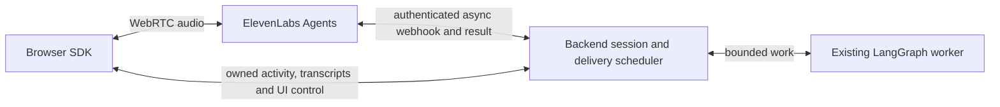

# ElevenLabs transport evaluation

Reviewed on 2026-11-02. The selected integration is Agents WebRTC with an authenticated
asynchronous **server webhook** for `delegate_task`. Browser audio stays direct; worker
requests and results no longer traverse client-tool callbacks. Offline verification and
live acceptance remain distinct; see [configuration and limits](elevenlabs.md).

## Selected path: Agents plus server tools

The browser uses a backend-minted conversation token and the official SDK for media. The
private agent has exactly one application tool, `delegate_task`, configured as a webhook
with `execution_mode=async`, interruptions allowed and a bounded response timeout. The
backend admits the job, keeps its pending result behind the existing silence gate, then
returns the bounded result on the provider's HTTP request. It never returns only a job-start
acknowledgement and assumes the provider will collect the result later.

The service route is separate from browser `/api` Origin policy. A stored provider header
secret and reserved conversation ID bind requests to sessions minted by this backend.
Model parameters cannot choose a principal, credential, worker or another session. HTTP
response correlation needs no fabricated provider invocation ID. Since a stable native
invocation ID is not established in the documented webhook schema, exact goals coalesce
per conversation; this intentionally limits repeated identical requests. Native idempotency
would need a verified provider contract before changing that policy.

The browser still supplies activity/transcripts and heartbeat for this browser adapter.
Missing observations hold delivery until expiry. Webhook transport therefore improves tool
ownership, but does not establish a server-only silence/event channel. A dedicated monitoring
capability would need separate account/contract evaluation. Closed media does not prove
upstream finalization; provider status and maximum duration remain required.

The original client-tool bridge was easier to test locally and exposed native tool-call IDs,
but coupled backend result delivery to browser JavaScript and polling. It has been removed.
ElevenLabs recommends webhook tools for server APIs and client tools for application UI
operations. Both public tool schemas describe asynchronous execution; actual continuing
speech and result narration need authorized live acceptance.

## Standalone Realtime alternative

The standalone Eleven Realtime API uses WebSocket audio rather than Agents SDK-managed
WebRTC. Public documentation describes ephemeral client credentials, so WebSocket transport
alone does not require relaying audio through this backend. It would require a separate
browser audio transport and an evaluation of control attachment, tool results, interruption,
provider closure and native compatibility. It is not implemented by this PR.

Agents is selected first to exercise the provider abstraction with a different tool execution
model. Neither path changes the voice-facing single-tool thesis or moves calculator,
documentation, Tavily or LangGraph execution into the browser/provider tool registry.

## Acceptance boundary

No paid call, agent/account mutation, tunnel, hosted callback configuration or measured relay
latency is performed here. Deterministic tests cover application contracts; live quality,
webhook reachability, interruption behaviour and provider deadlines remain pending. Every new
external call retains timeout/body limits and explicit failure behaviour. A callback failure
does not cause automatic replay of work or switching to another voice vendor.

Sources: [webhook tools](https://elevenlabs.io/docs/eleven-agents/customization/tools/webhook-tools),
[client tools](https://elevenlabs.io/docs/eleven-agents/customization/tools/client-tools),
[async webhook schema](https://github.com/elevenlabs/elevenlabs-python/blob/main/src/elevenlabs/types/webhook_tool_config_input.py),
[dynamic variables](https://elevenlabs.io/docs/eleven-agents/customization/personalization/dynamic-variables),
[standalone Realtime](https://elevenlabs.io/docs/eleven-agents/guides/openai-realtime-compatibility),
[implementation guide](elevenlabs.md).
