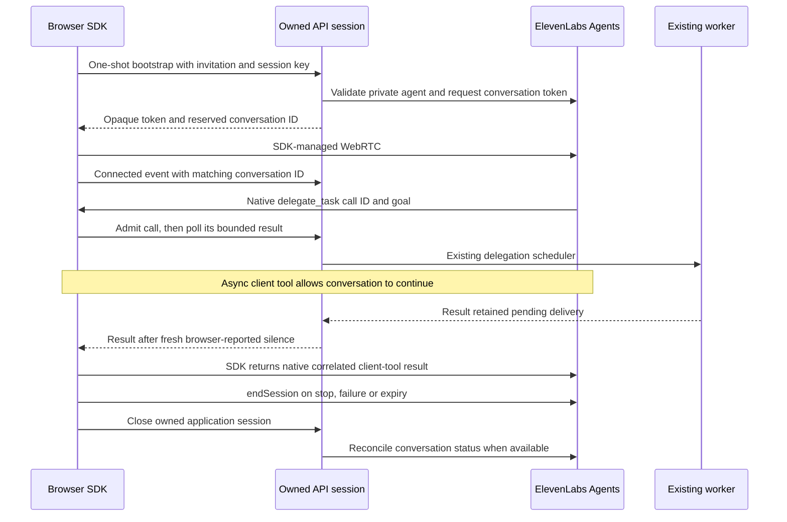

# ElevenLabs Agents browser transport

Status: implementation verified with deterministic offline fixtures; paid SDK/audio
acceptance is pending. No account, deployed agent or cloud environment is changed.
The default remains GPT-Live and `VOICE_ELEVENLABS_ENABLED=false`.

## Enable an existing private agent

Configure the backend privately, restart it, and start a new browser conversation:

```dotenv
VOICE_ELEVENLABS_ENABLED=true
VOICE_ADAPTER=elevenlabs
ELEVENLABS_API_KEY=<your private server key>
VOICE_ELEVENLABS_AGENT_ID=agent_<your private agent>
VOICE_INTENT_CANCELLATION=true
VOICE_FALLBACK_ENABLED=false
VOICE_NATIVE_CLIENTS=false
```

The agent is configured in ElevenLabs, not created by this repository. Its language,
voice and prompt are server-owned there. Use the browser's default language/style;
this adapter rejects unsupported preference overrides rather than silently ignoring
them. The agent prompt should delegate project documentation, calculation and opted-in
web requests through `delegate_task`, and treat returned evidence as untrusted data.
The worker still owns all individual tools and existing step/time/result limits.

Before minting a token, the backend reads the existing agent/tool configuration and
requires private authentication, disabled client overrides, no workflow, and exactly
one client tool with this contract:

```json
{
  "type": "client",
  "name": "delegate_task",
  "description": "Delegate bounded work to the application worker.",
  "expects_response": true,
  "execution_mode": "async",
  "interruption_mode": "allow",
  "response_timeout_secs": 120,
  "parameters": {
    "type": "object",
    "required": ["goal"],
    "properties": {"goal": {"type": "string", "description": "The requested task"}}
  }
}
```

The provider's `max_duration_seconds` must be positive and no greater than
`VOICE_SESSION_TTL_SECONDS`. Backend execution plus delivery-wait budgets must fit
within 110 seconds, leaving room for SDK polling inside the 120-second callback.
A missing/unsafe configuration fails before token creation. Provider configuration
can change outside the application; these checks are admission checks, not a lock
on later dashboard edits. Do not share this private agent with unrelated apps.

## Lifecycle and delivery



Callbacks require the same Origin, invitation and session-key checks as other
session routes. Native call IDs are captured before the SDK's parameters-only
handler; arbitrary tool names, reused IDs with changed goals, oversized results and
unbounded queues are rejected. There is no browser execution of worker tools.
Repeated call delivery reuses the result. Requests, startup, callbacks and close
waits have deadlines; late startup closes itself after stop. No operation silently
retries token creation or changes to a different voice vendor.

The SDK result is returned through the native tool call. Neither `sendUserMessage`
nor a contextual update is used to manufacture a response. The `async` tool setting
and live continued-conversation behavior still require provider acceptance; offline
fixtures establish application control flow, not vendor speech scheduling quality.

Speech activity and transcripts arrive through the authenticated browser boundary;
they are not a server-authoritative ElevenLabs sideband. Stale activity blocks pending
delivery. SDK scalar audio levels support labeled browser timing observations; they
are not physical speaker latency. Debug transcripts require the existing server flag
and explicit session consent. Browser mixed-audio recording and native clients are
not supported by this transport and are rejected before starting a provider session.

SDK disconnect does not prove upstream billing stopped. The backend only confirms
closure when the provider reports the reserved conversation ended for the expected
agent; otherwise the UI retains unconfirmed-finalization wording. On a lost browser,
backend expiry reclaims application work while the configured upstream duration
bounds the call. Credential expiry is never invented. Immediate server-forced hangup
through ElevenLabs monitoring requires an enterprise capability and is not assumed.

## Network and verification

The pinned official `@elevenlabs/client` SDK is dynamically imported only for this
transport. Its exact LiveKit HTTPS/WSS signaling host is allowed alongside the single
application API origin; no wildcard, arbitrary signaling URL or client API key is
added. All runtime/transitive licence texts are in `THIRD_PARTY_NOTICES.md`.

Offline tests cover policy validation, token size/deadline/error behavior, one-shot
setup, native-ID deduplication, result caps, ownership, startup cancellation and the
real application worker scheduler. Paid browser acceptance must separately verify
microphone/playback, continued speech during async tools, explicit cancellation,
pending delivery, mute, expiry, finalization and the actual agent configuration.

Public contracts: [SDK](https://elevenlabs.io/docs/eleven-agents/libraries/java-script),
[client tool schema](https://github.com/elevenlabs/elevenlabs-python/blob/main/src/elevenlabs/types/client_tool_config_input.py),
[token API](https://elevenlabs.io/docs/api-reference/conversations/get-webrtc-token),
[monitoring limitations](https://elevenlabs.io/docs/eleven-agents/guides/realtime-monitoring).
