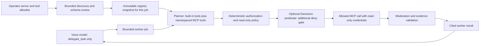
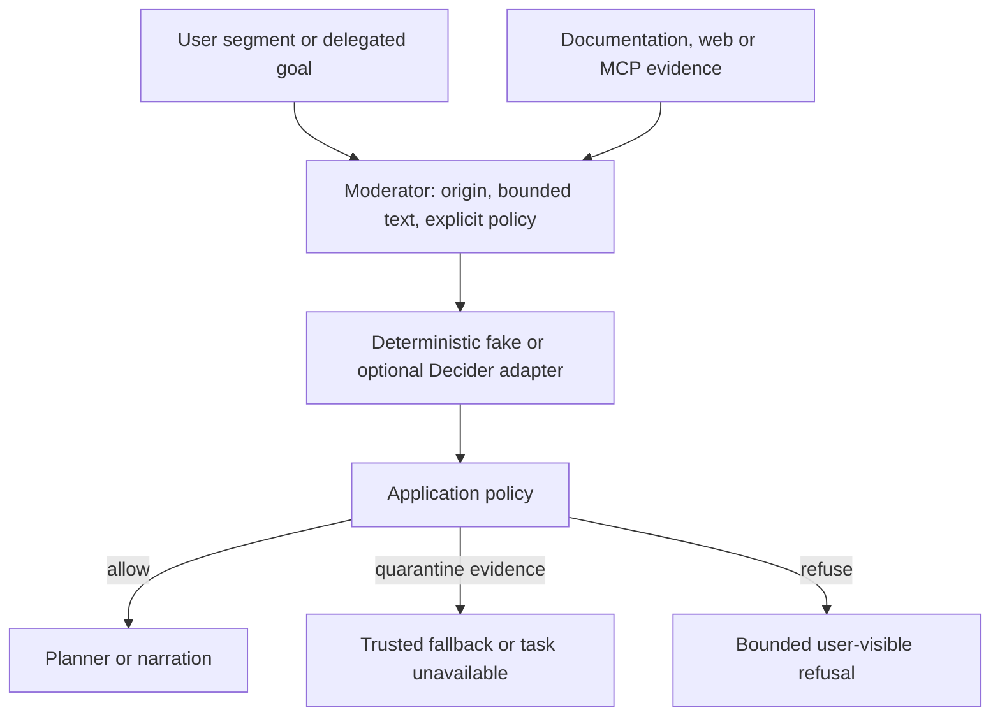
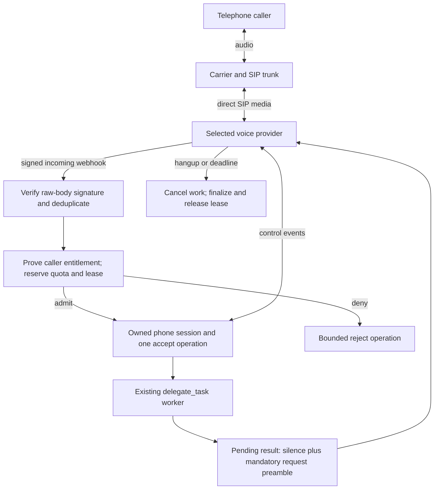
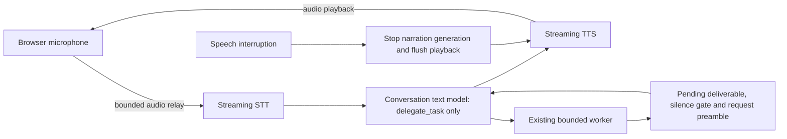

# Future extensions

Status: proposals only, 2026-11-02 (reviewed against 0.2.0 on 2026-11-03). MCP, moderation, SIP and a cascaded voice pipeline
are not implemented by this document. Their offline and live acceptance are both pending.
The switches below are proposed names, **not settings accepted by the current application**.
Since 0.2.0 the runtime enables capabilities from credentials and explicit endpoints, and the
loader ignores obsolete on/off flags; an extension that can be enabled that way should follow
that rule, and a blanket flag is justified only where no credential or endpoint exists to key
off. Each implementation needs its own reviewed PR, dependencies/licences and offline tests;
paid acceptance requires separate explicit authorization.

| Extension | Proposed switch, default off | Main prerequisite | Acceptance evidence |
| --- | --- | --- | --- |
| Moderation hook | `VOICE_MODERATION=false` | Origin-aware policy and shared typed contract | Adversarial fakes, then authorized quality evals |
| Worker MCP client | `VOICE_MCP_ENABLED=false` | Audited read-only registry and moderation boundary | Fake servers, schema/timeout/cancellation tests |
| Telephone SIP | `VOICE_SIP_ENABLED=false` | Admission ADR, carrier and signed webhooks | Duplicate/race fakes, then an authorized call |
| Cascaded voice | `VOICE_CASCADE_ENABLED=false` | Audio-relay ADR and transport capabilities | Synthetic audio tests, then measured voice benchmarks |

The voice-facing contract stays one tool: `delegate_task`. New tools belong to the worker.
Ordinary speech interruption pauses narration; it does not cancel useful worker jobs.
Pending results retain bounded silence-gated delivery, explicit cancellation and expiry.
Provider failures must not replay side-effecting requests or silently switch vendors.

## Worker as an MCP client

MCP supplies tool discovery and invocation; it does not grant a server trust or read-only
permission. The current specification describes paginated/cached `tools/list` and change
notifications. Its tool annotations are hints, not a security boundary. The following cache
and policy choices are this project's proposal, not requirements imposed by MCP.

Implementation outline:

1. An operator-owned server allowlist supplies fixed transport endpoints and environment
   variable names for credentials. Never discover servers from speech, search results or
   tool output. Do not forward invitation codes or provider keys to MCP servers.
2. Discover at worker startup with bounded connection/list timeouts and bounded pagination,
   tool count, schema depth and description bytes. Cache per server and authorization scope.
   Proposed defaults: 3-second request timeout, 5-second total discovery budget and 60-second
   cache lifetime. A refresh/change notification builds a new validated registry atomically;
   each delegation retains its original snapshot. No discovery on every planner step.
3. Prefix tool names with a stable server identifier and reject collisions. Bound the total
   advertised tool set so Decisions choice questions fit their current limit, reserving the
   direct-answer and refusal choices. The built-in calculator, documentation and web search
   remain available when an optional MCP server is unavailable.
4. The DecisionsPlanner chooses from that bounded snapshot. Before execution, require an
   audited server/tool allowlist, schema validation, read-only credentials and transport/egress
   restrictions. Then an optional read-only predicate can reject an otherwise authorized call
   below the configured threshold. A classification timeout rejects the MCP call. Neither
   a high probability nor `readOnlyHint=true` can authorize an unaudited tool.
5. Bound call time and total result bytes, reject unsupported content types, and propagate
   cancellation. Do not automatically retry an ambiguous invocation. Quarantine untrusted
   output before the planner sees it; validate source indices and keep at most three citations.
   A failure returns an explicit unavailable result or trusted built-in fallback, never a
   fabricated successful answer. Keep MCP tool errors separate from transport failures.
6. Add ADR 010 for the trust model before implementation. Keep the shared tool/moderation
   contract importable by the worker without a dependency back from the agent to the API.
   Both local and private remote-worker execution must apply the same policy.

The example server would expose one read-only calendar lookup from an operator-configured
HTTPS ICS URL. Proposed bounds: allowlisted public destination, redirects disabled, private
network/DNS targets rejected, 256 KiB input, 128 returned events, bounded recurrence expansion
and a two-second fetch deadline. Calendar text is untrusted data. No arbitrary URL, file access,
calendar mutation or shell tool is exposed. A deterministic calendar fixture replaces networking
in tests. These limits require review against the final ICS parser and its licence.

Offline acceptance must cover changing catalogs between jobs, pagination overflow, malformed
schemas, stale refreshes, unavailable servers, colliding names, cancelled calls, a falsely
read-only tool and injected output. Fakes prove application enforcement, not remote-server
honesty. Live compatibility requires a separately authorized server and recorded version.

## Moderation hook

Introduce one origin-aware `Moderator` boundary for user transcript segments, delegated goals
and tool evidence before they reach planning or narration. Its typed result should distinguish
allow, quarantine and refuse, with fixed reason codes. User requests are not equivalent to
instructions embedded inside documentation, web snippets or MCP results.

The proposed implementation lives behind an injected contract with a fake, plus an optional
Decider adapter under `backend/src/voice_delegate/moderation/`. Questions about instructions
addressed to the assistant and unsuitable narration are advisory inputs to deterministic
policy. They must not turn every imperative user request into a refusal or replace existing
cancellation-intent logic. Classification cannot prove that content is safe.

Once enabled, unavailable classification of external evidence quarantines that evidence rather
than silently allowing it. Define user/goal failure behavior separately: preserve the session,
reject or defer the affected task with a reason, and never execute blocked tool content.
Bound input bytes, response size, timeout, classifier calls and per-session estimated cost.
Keep only numeric counters and fixed reason labels in normal telemetry; do not add transcript
or audio logging. Existing explicit debug consent remains a separate facility.

Offline tests should inject instructions through project documentation, Tavily and a fake MCP
server, including forged citations, multilingual text, quoted instructions, classifier failure
and false-positive legitimate requests. Test that denied output never reaches the planner or
narrator and that one job cannot contaminate another. Real classifier quality, false-positive
rates and live latency remain pending until authorized evaluation.

## Telephone entry through SIP

A SIP caller replaces the browser transport, while the backend retains admission, the worker,
quotas and result delivery. Direct provider SIP media need not traverse this backend. OpenAI
currently documents distinct Live and Realtime acceptance surfaces; choose one handler per
incoming call rather than accepting through both.

Implementation needs a dedicated admission ADR. Caller ID and SIP headers alone do not prove
entitlement. Decide an authenticated account/one-time code or a constrained test allowlist,
concurrent call limits, conservative usage reservations and rate limits before opening ingress.
Verify signatures on the raw body, timestamp/replay windows and duplicate deliveries. A call
identity and one owner serialize accept/reject/hangup races. Retain opaque provider identities;
never substitute a browser session UUID for an upstream call ID.

For the current Live surface, the public guide describes `live.transport.incoming` and actions
under `/v1/live/sessions/{session_id}`; Realtime uses `realtime.call.incoming` and
`/v1/realtime/calls/{call_id}`. Revalidate these contracts during implementation. A duplicated
webhook or ambiguous accept response must not create a second session. Rejecting admission
does not guarantee zero carrier/provider charges.

A telephone session cannot rely on browser heartbeats or a Cancel button. Require provider-side
maximum duration, signed/owned disconnect events, a server janitor and bounded finalization.
Delayed delivery always includes the original-request preamble. Define explicit spoken/DTMF
cancellation separately and test it; ordinary speech must preserve work. No automatic replay
of worker jobs or cross-vendor voice change on recovery.

Use deterministic webhook/control fakes for authentication failures, exhausted quota, duplicate
acceptance, lost disconnects, cancellation, timeout and unconfirmed close. Actual carrier
interoperability, voice latency and charges need a separately authorized call. Recording and
retention require their own consent design; default to neither audio nor transcript recording.

## Cascaded STT, text model and TTS

A cascaded adapter streams speech-to-text, a conversational text model and text-to-speech as
separate stages. The conversational model still knows only `delegate_task`; the existing
LangGraph worker remains separate. This is an optional comparison with speech-to-speech,
not a replacement for the current working browser transport.

First write an ADR justifying backend audio transit, privacy, operational cost and backpressure.
The current Agents WebRTC integration does not create an audio relay to reuse. If another
adapter has introduced one by implementation time, evaluate it before adding a second relay.
Extend typed transport capabilities and connection negotiation explicitly; do not fabricate
an SDP answer for a WebSocket/audio-chunk transport.

Bound format, sample rate, frame bytes, queue depth, total duration and every stage's timeout.
Use monotonic sequence/generation identifiers to discard late STT/TTS chunks. Interruption
stops old TTS and buffered playback without invalidating worker jobs; explicit cancellation
and session end still cancel the relevant work. A late result goes through the same silence
gate, expiry and configurable preamble. Define partial STT commits and tool-result ordering
before implementation, including reconnection and overlapping input/output.

Failure of STT, text generation or TTS must terminate or explicitly recover that transport
without silently sending audio to a different vendor. Keep stages independently injectable
with deterministic fake chunks, clocks and cancellation. No audio/transcript logs by default.
Add STT, text and TTS usage components to the versioned cost assumptions, keeping missing
usage partial. Measure end-of-user-speech to first playback and total turn duration with the
existing benchmark harness, with stage traces containing no content. Publish measured relay
latency only after authorized live tests; do not infer it from loopback peers.

## Suggested implementation order and review gates

1. Complete formal ElevenLabs live acceptance (the maintainer reports it working live on the
   deployed backend) and reconcile one session's cost estimate with reported usage. Keep offline and live evidence separate in the roadmap.
2. Agree moderation policy and implement its common hook, then the audited read-only MCP
   client and ICS example. Approve ADR 010 before enabling remote tools.
3. Decide whether SIP and the cascaded comparison justify their extra admission, privacy and
   operational surfaces. Implement each in its own opt-in PR if approved.

Each extension must preserve disabled-mode behavior, pass the normal backend/frontend checks,
update architecture/glossary/roadmap, document rollback and add new dependency attribution.
A passing fake or compile test is not evidence of live safety, provider support or audio quality.

## Public contract references

Checked on 2026-11-02. These sources describe provider/protocol contracts, not this project's
unimplemented application policy. Recheck the chosen versions before writing integration code.

- [MCP tools: discovery, invocation and changes](https://modelcontextprotocol.io/specification/2026-07-28/server/tools)
- [MCP schema: tool annotations are hints](https://modelcontextprotocol.io/specification/2026-07-28/schema)
- [OpenAI telephony and SIP](https://developers.openai.com/api/docs/guides/voice-sip)
- [OpenAI voice architectures, including chained pipelines](https://developers.openai.com/api/docs/guides/voice-agents)
- [Existing cancellation contract](decisions/009-cancellation-is-intent.md)
- [Current ElevenLabs implementation and limits](elevenlabs.md)
- [Current cost assumptions](cost-estimates.md)
