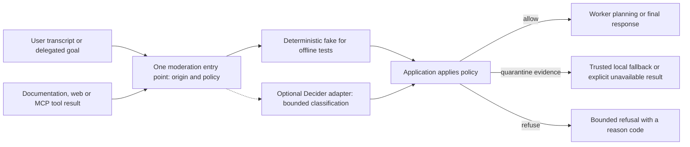
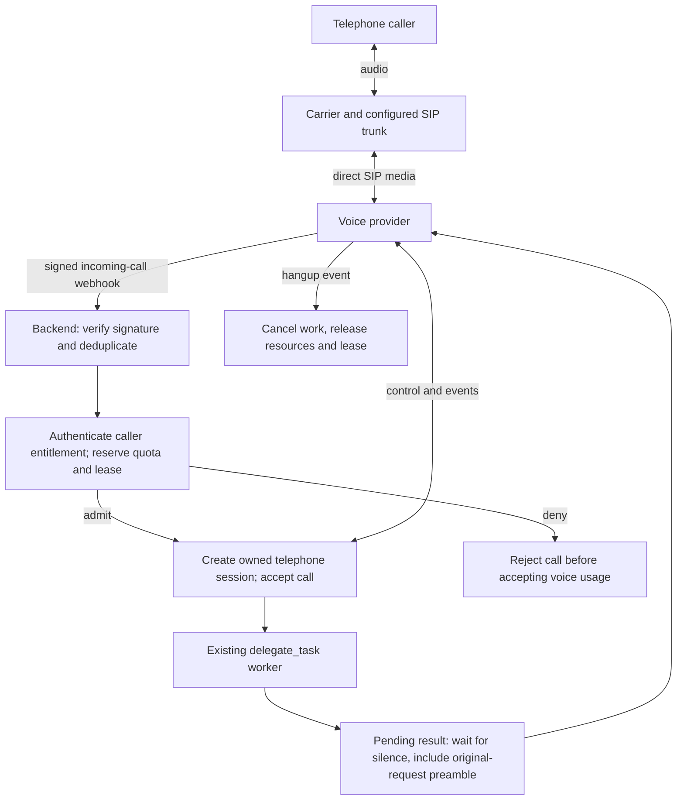

# Deferred extensions: moderation and SIP

Status: design notes only, deferred by the maintainer on 2026-11-02. No route, flag,
moderation service or telephony integration is implemented by these notes. They do
not claim offline or live acceptance. The current task is the ElevenLabs Agents draft.

## Moderation extension

A future `Moderator` protocol would accept bounded text, its origin and an explicit
policy, then return a typed decision such as allow, quarantine or refuse. Origins
include user speech, delegated goals and tool evidence. The policy must distinguish
legitimate user instructions from instructions embedded inside untrusted tool output.
It is separate from cancellation intent classification.

Proposed implementation scope:

- One `backend/src/voice_delegate/moderation/` interface with an injected fake and a
  separately enabled implementation. Any new flag defaults off.
- Bounded classifier requests, total timeout, typed output and explicit failure
  behavior. Once enabled, unavailable classification of external evidence must not
  silently count as an allow; quarantine it and use a safe fallback or fail the task.
- User-visible reason categories and aggregate metrics without transcript or tool
  content. No automatic conversation uploads or transcript logging.
- Adversarial offline tests for injected instructions, forged citations, unavailable
  classification and false positives. Scripted classifiers verify application policy,
  not the real model's safety or accuracy; quality requires separately authorized evals.

Classification is advisory input to deterministic policy. It cannot prove that a
remote tool is read-only or prevent side effects by itself. Read-only credentials,
server/tool allowlists and execution limits remain mandatory independently.

The planned MCP client originally includes this hook. If that work proceeds before
full moderation, explicitly decide its reduced scope: audited read-only tools and
strict output handling, or a minimal quarantine hook implemented with MCP. Do not
silently treat MCP descriptions or `readOnlyHint` as authorization.

## Telephone entry through SIP

A future telephone entry point would reuse session admission, worker jobs,
`delegate_task`, cancellation and pending-result budgets. The browser is replaced by
a SIP carrier connected to the voice provider. With direct SIP, the application need
not relay call audio. The backend still decides whether a call can be accepted.

An implementation would require:

1. A dedicated admission ADR. Decide how callers prove entitlement without a browser
   invitation field. Caller number and SIP headers alone are not authentication.
2. A carrier/number and SIP configuration, signed webhook verification, delivery
   deduplication and one handler owning accept/reject. Exact APIs differ between
   GPT-Live and Realtime; use the chosen provider's current documented contract.
3. A telephone session transport beside browser negotiation, with no fabricated SDP,
   no reliance on browser heartbeats and a provider-side maximum call duration.
4. Explicit telephone cancellation semantics and a required original-request preamble
   for delayed results. Do not assume a browser Cancel button exists or that speech
   automatically cancels worker jobs. Choose and verify a supported cancellation path.
5. Bounded accept/close operations, admission failure behavior, disconnect cleanup,
   conservative usage reservations and no automatic replay of jobs after failure.
6. Deterministic incoming-call and control fakes before a separately authorized paid
   call. Measure actual timing and billable usage; do not estimate them from web tests.

Browser playback/recording controls do not carry over automatically. Decide recording,
consent and retention separately; default to no audio/transcript recording. A public
phone number is a new admission surface and is not enabled merely by adding a route.

## Suggested order

Complete the ElevenLabs transport and lifecycle, then session cost estimates and UI
integration. Keep moderation and SIP deferred until their policies and acceptance
budgets are agreed. MCP and a cascaded STT/text-model/TTS pipeline remain separate
pieces of work; this document does not authorize either implementation.

## Public contract references

- [OpenAI telephony and SIP](https://developers.openai.com/api/docs/guides/voice-sip)
- [MCP tools and trust considerations](https://modelcontextprotocol.io/specification/2026-07-28/server/tools)
- [Existing cancellation design](decisions/009-cancellation-is-intent.md)
- [ElevenLabs implementation draft](elevenlabs.md)
