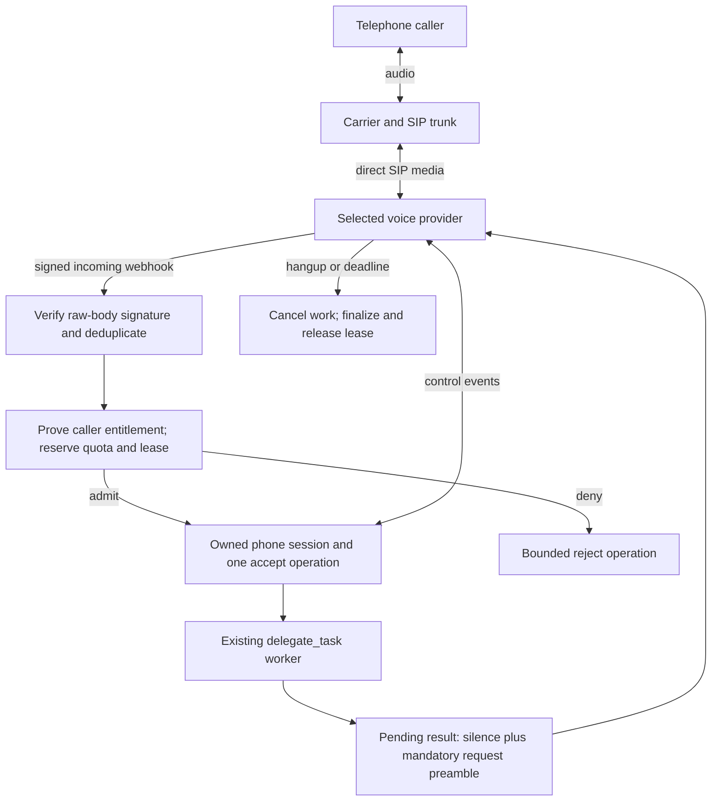
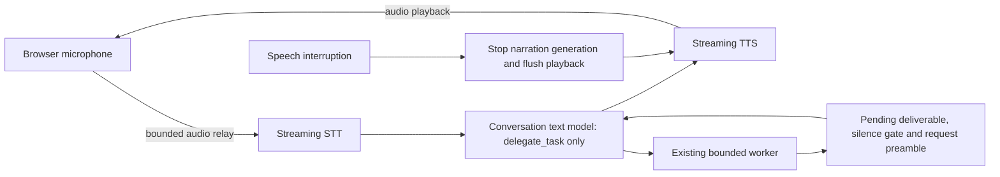

# Future extensions

Status: proposals, 2026-11-02 (reviewed against 0.2.0 on 2026-11-03; updated 2026-11-04).
The moderation hook and the worker MCP client are now implemented as opt-in features; see
[Implemented extensions](#implemented-extensions). Telephone SIP and a cascaded voice pipeline
remain proposals that this document does not implement. Their offline and live acceptance are
both pending, and the switches below are proposed names, **not settings accepted by the
current application**.
Since 0.2.0 the runtime enables capabilities from credentials and explicit endpoints, and the
loader ignores obsolete on/off flags; an extension that can be enabled that way should follow
that rule, and a blanket flag is justified only where no credential or endpoint exists to key
off. Each implementation needs its own reviewed PR, dependencies/licences and offline tests;
paid acceptance requires separate explicit authorization.

| Extension | Proposed switch, default off | Main prerequisite | Acceptance evidence |
| --- | --- | --- | --- |
| Telephone SIP | `VOICE_SIP_ENABLED=false` | Admission ADR, carrier and signed webhooks | Duplicate/race fakes, then an authorized call |
| Cascaded voice | `VOICE_CASCADE_ENABLED=false` | Audio-relay ADR and transport capabilities | Synthetic audio tests, then measured voice benchmarks |

The voice-facing contract stays one tool: `delegate_task`. New tools belong to the worker.
Ordinary speech interruption pauses narration; it does not cancel useful worker jobs.
Pending results retain bounded silence-gated delivery, explicit cancellation and expiry.
Provider failures must not replay side-effecting requests or silently switch vendors.

## Implemented extensions

Both are off by default, add no dependency and leave disabled-mode behavior unchanged.

| Extension | Enabled by | Decision record | Offline evidence |
| --- | --- | --- | --- |
| Moderation hook | `VOICE_MODERATION` (needs `OPENAI_API_KEY` on the worker host) | [ADR 013](decisions/013-moderation-boundary.md) | `backend/tests/test_moderation.py` |
| Worker MCP client | Listing servers in `VOICE_MCP_SERVERS` (requires moderation) | [ADR 010](decisions/010-mcp-trust-model.md) | `backend/tests/test_mcp.py` |

An origin-aware `Moderator` reviews the delegated goal and each documentation, web or MCP
result before the planner sees it. The MCP client calls only operator-allowlisted read-only
tools from immutable, cached, schema-reviewed per-job snapshots and passes every result
through moderation. See the [worker guide](worker.md#optional-moderation) and
[architecture](architecture.md#optional-moderation-boundary). Fakes prove that the application
enforces its policy, allowlists and bounds; they do not prove remote-server honesty or
classifier quality.

Remaining work, not yet built:

- Authorized quality evaluation of the real classifier: false-positive and false-negative
  rates, multilingual text and live latency.
- Review of raw transcript segments before they become a delegated goal.
- A trusted documentation fallback when quarantined web evidence leaves a job with no answer;
  today the job ends as incomplete.
- Per-session (not only per-job) moderation cost limits.
- The read-only calendar example server: an operator-configured HTTPS ICS URL with a public
  destination allowlist, disabled redirects, rejected private network targets, bounded input,
  events and recurrence expansion, and a deterministic fixture instead of networking in tests.
  Its limits need review against the final ICS parser and licence.
- Live MCP compatibility with a separately authorized server and recorded version, plus a
  recheck of the pinned protocol versions.
- Optional MCP argument building for multi-field tools under the Decisions planner, which can
  currently call only tools whose single required parameter is text.

## Telephone entry through SIP

A SIP caller replaces the browser transport, while the backend retains admission, the worker,
quotas and result delivery. Direct provider SIP media need not traverse this backend. OpenAI
currently documents distinct Live and Realtime acceptance surfaces; choose one handler per
incoming call rather than accepting through both.

Implementation needs a dedicated admission ADR. Caller ID and SIP headers alone do not prove
entitlement. Decide an authenticated account/one-time code or a constrained test allowlist,
concurrent call limits, conservative usage reservations and rate limits before opening ingress.
Verify signatures on the raw body, timestamp/replay windows and duplicate deliveries. A call
identity and one owner serialize accept/reject/hangup races. Retain opaque provider identities;
never substitute a browser session UUID for an upstream call ID.

For the current Live surface, the public guide describes `live.transport.incoming` and actions
under `/v1/live/sessions/{session_id}`; Realtime uses `realtime.call.incoming` and
`/v1/realtime/calls/{call_id}`. Revalidate these contracts during implementation. A duplicated
webhook or ambiguous accept response must not create a second session. Rejecting admission
does not guarantee zero carrier/provider charges.

A telephone session cannot rely on browser heartbeats or a Cancel button. Require provider-side
maximum duration, signed/owned disconnect events, a server janitor and bounded finalization.
Delayed delivery always includes the original-request preamble. Define explicit spoken/DTMF
cancellation separately and test it; ordinary speech must preserve work. No automatic replay
of worker jobs or cross-vendor voice change on recovery.

Use deterministic webhook/control fakes for authentication failures, exhausted quota, duplicate
acceptance, lost disconnects, cancellation, timeout and unconfirmed close. Actual carrier
interoperability, voice latency and charges need a separately authorized call. Recording and
retention require their own consent design; default to neither audio nor transcript recording.

## Cascaded STT, text model and TTS

A cascaded adapter streams speech-to-text, a conversational text model and text-to-speech as
separate stages. The conversational model still knows only `delegate_task`; the existing
LangGraph worker remains separate. This is an optional comparison with speech-to-speech,
not a replacement for the current working browser transport.

First write an ADR justifying backend audio transit, privacy, operational cost and backpressure.
The current Agents WebRTC integration does not create an audio relay to reuse. If another
adapter has introduced one by implementation time, evaluate it before adding a second relay.
Extend typed transport capabilities and connection negotiation explicitly; do not fabricate
an SDP answer for a WebSocket/audio-chunk transport.

Bound format, sample rate, frame bytes, queue depth, total duration and every stage's timeout.
Use monotonic sequence/generation identifiers to discard late STT/TTS chunks. Interruption
stops old TTS and buffered playback without invalidating worker jobs; explicit cancellation
and session end still cancel the relevant work. A late result goes through the same silence
gate, expiry and configurable preamble. Define partial STT commits and tool-result ordering
before implementation, including reconnection and overlapping input/output.

Failure of STT, text generation or TTS must terminate or explicitly recover that transport
without silently sending audio to a different vendor. Keep stages independently injectable
with deterministic fake chunks, clocks and cancellation. No audio/transcript logs by default.
Add STT, text and TTS usage components to the versioned cost assumptions, keeping missing
usage partial. Measure end-of-user-speech to first playback and total turn duration with the
existing benchmark harness, with stage traces containing no content. Publish measured relay
latency only after authorized live tests; do not infer it from loopback peers.

## Other ideas, not planned

- **Error tracking with Sentry.** Traces, metrics and the Grafana dashboards already cover
  observability. Sentry would add grouped exceptions and alerts for the hosted demo, including
  browser crashes. If added, it must be opt-in (enabled only when a DSN is set), send no
  request bodies, transcripts, session keys or provider keys, and have tests that prove the
  scrubbing.

## Suggested implementation order and review gates

1. Complete formal ElevenLabs live acceptance (the maintainer reports it working live on the
   deployed backend) and reconcile one session's cost estimate with reported usage. Keep offline and live evidence separate in the roadmap.
2. Done as opt-in features: the moderation hook (ADR 013), then the audited read-only MCP
   client (ADR 010). The ICS example and the live evaluations above remain open.
3. Decide whether SIP and the cascaded comparison justify their extra admission, privacy and
   operational surfaces. Implement each in its own opt-in PR if approved.

Each extension must preserve disabled-mode behavior, pass the normal backend/frontend checks,
update architecture/glossary/roadmap, document rollback and add new dependency attribution.
A passing fake or compile test is not evidence of live safety, provider support or audio quality.

## Public contract references

Checked on 2026-11-02. These sources describe provider/protocol contracts, not this project's
unimplemented application policy. Recheck the chosen versions before writing integration code.

- [MCP tools: discovery, invocation and changes](https://modelcontextprotocol.io/specification/2026-07-28/server/tools)
- [MCP schema: tool annotations are hints](https://modelcontextprotocol.io/specification/2026-07-28/schema)
- [OpenAI telephony and SIP](https://developers.openai.com/api/docs/guides/voice-sip)
- [OpenAI voice architectures, including chained pipelines](https://developers.openai.com/api/docs/guides/voice-agents)
- [Existing cancellation contract](decisions/009-cancellation-is-intent.md)
- [Current ElevenLabs implementation and limits](elevenlabs.md)
- [Current cost assumptions](cost-estimates.md)
