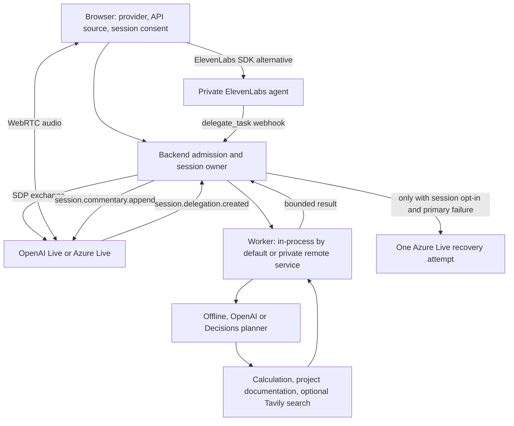

# Session and delegation flow

The browser selects a voice provider and API source before starting. Personal keys require
no invitation, are sent once over HTTPS, and stay in the API/worker process memory only for
that session. In public-demo deployments, personal leases leave one shared slot
reserved for platform access. Platform API uses backend keys and the configured invitation and daily quotas.
No provider key is included in browser connection answers.

Live in this application uses **client delegation**. A delegation event asks our backend
for work; it does not automatically call a hidden model. The backend chooses the worker.
Live also supports a separate Responses delegation mode, where a configured Responses
model handles reasoning, but this project does not select that mode.

Recovery is unchecked by default, available only for OpenAI primary, generation-checked
and limited to one attempt. Personal mode requires personal Azure credentials. A new
peer receives bounded text context, never audio or tool execution replay; lifetime does
not reset. Only opted-in platform sessions reserve the second voice-session allowance.

Debug recording requires its own checkbox, initially off and reset at session end, in
both API modes. Normal OTel traces/metrics exclude conversation text and keys; recording
is a separate bounded file with 24-hour cleanup while the backend runs.

The application automatically enables costs, provider controls, intent cancellation,
audio timing, native support (still origin-allowlisted), debug availability and OTel.
Optional providers/search become available from complete credentials. Former feature
enable flags are ignored. Remaining operational switches include:

| Setting | Meaning |
|---|---|
| `VOICE_DEMO_ENABLED` | New-conversation admission switch, default true; affects personal and platform sessions. |
| `VOICE_PUBLIC_DEMO` | Funded invitation quotas and durable shared leases, default false; unrelated to the offline example. |
| `VOICE_API_DOCS` | Production API documentation, default false; local docs are enabled. |
| `VOICE_TRUST_PROXY` | Trust forwarded addresses for rate limiting only behind the configured proxy hops, default false. |
| `VOICE_DECISIONS_CANCEL` | Optional semantic cancellation adviser, default false; separate from a Decisions worker planner. |
| `VOICE_SESSION_SUMMARY` | Optional generated recap at user close, default false. One worker-model call on the bounded recent transcript, with the session's OpenAI key (the visitor's own key for personal sessions); no key or an offline worker means no summary. ElevenLabs sessions then also send their transcript to OpenAI. Expiry cleanup never summarizes, and any failure keeps the extractive recap. |
| `VOICE_WORKER_EXECUTION` | `local` by default; `remote` selects the authenticated private worker service. |
| `VOICE_WORKER_MODE` | Automatically OpenAI with a key, otherwise offline; explicit `offline`, `openai` or `decisions` overrides. |

Implementation: [factory](../backend/src/voice_delegate/api/app.py),
[session manager](../backend/src/voice_delegate/session/manager.py),
[Azure recovery](../backend/src/voice_delegate/session/recovery.py),
[personal access](../backend/src/voice_delegate/personal.py),
[worker planner](../backend/src/voice_delegate/delegation/planner.py).
See [configuration](configuration.md), [personal API](personal-api.md),
[Azure setup](azure-setup.md) and [operations](operations.md).
